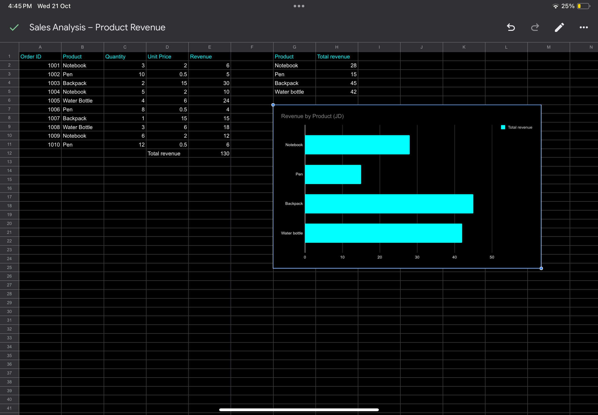

Sales Analysis Case Study

1. Project Overview

This beginner-friendly case study explores how a small online store can use sales data to understand business performance.

The goal is to practice analytical thinking and learn how data can support business decisions.

2. Business Question

How can an online store understand its sales performance and identify opportunities to improve?

3. Key Questions

* Which products generate the most revenue?
* Which products sell the most units?
* How can sales data help a business make better decisions?

4. Data and Method

This project will use a small sample sales dataset containing product names, quantities sold, and prices.

Revenue can be calculated using:

Revenue = Quantity Sold × Price per Unit

5. Analysis Plan

1. Organize the sales data in a spreadsheet.
2. Calculate revenue for each sale.
3. Compare revenue across products.
4. Identify patterns and possible business opportunities.

6. Business Recommendations

Recommendations will be added after analyzing the sample data. They will be based on the results rather than assumptions.

7. Skills Practiced

* Business question development
* Spreadsheet organization
* Basic calculations
* Revenue analysis
* Communicating findings

8. Next Steps

I will add a sample dataset, perform the analysis in Excel or Google Sheets, and document the results and recommendations.

9. Project Status

In progress — the analysis and findings will be added as I develop my practical skills.
10. Results and Findings

Total Revenue

The sample store generated 130 JD in total revenue across 10 orders.

Revenue by Product

Product	Total Revenue
Backpack	45 JD
Water Bottle	42 JD
Notebook	28 JD
Pen	15 JD

Key Findings

* Backpacks generated the highest revenue at 45 JD.
* Water bottles ranked second, generating 42 JD.
* Pens generated the lowest revenue at 15 JD.

Business Recommendations

* Review backpack sales to understand what makes this product perform well.
* Monitor water bottle sales because their revenue is close to that of backpacks.
* Investigate whether promotions or product bundles could improve pen sales.

Limitations

This analysis uses fictional sample data and only 10 orders. The findings cannot be assumed to represent a real business.

Skills Practiced

* Calculating revenue using spreadsheet formulas
* Summarizing data by product 
* Comparing business performance
* Communicating findings and recommendations
* ## Revenue by Product

The chart below visualizes revenue for each product using Google Sheets.

